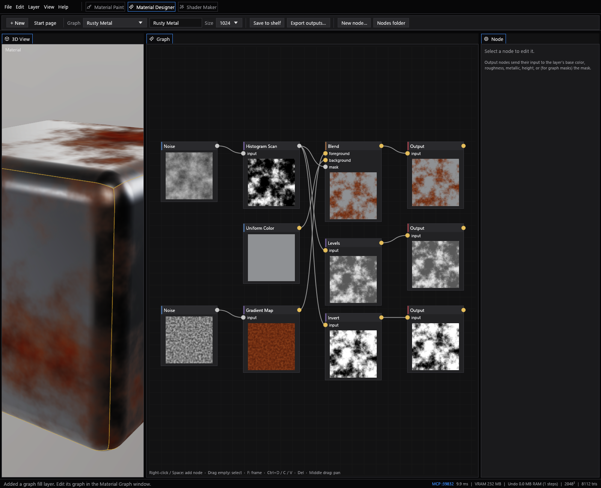
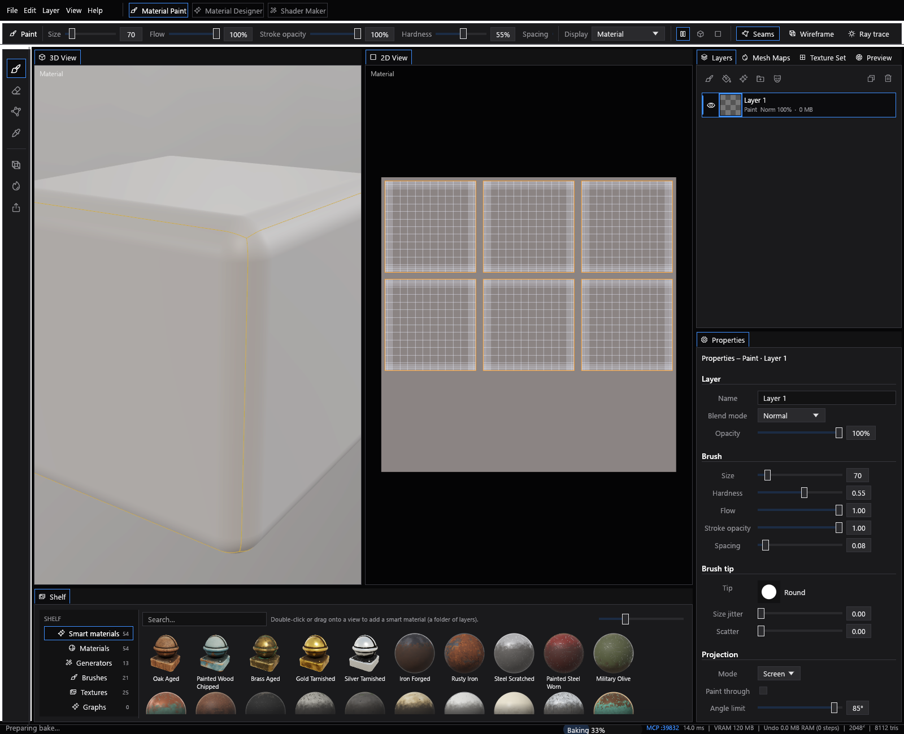
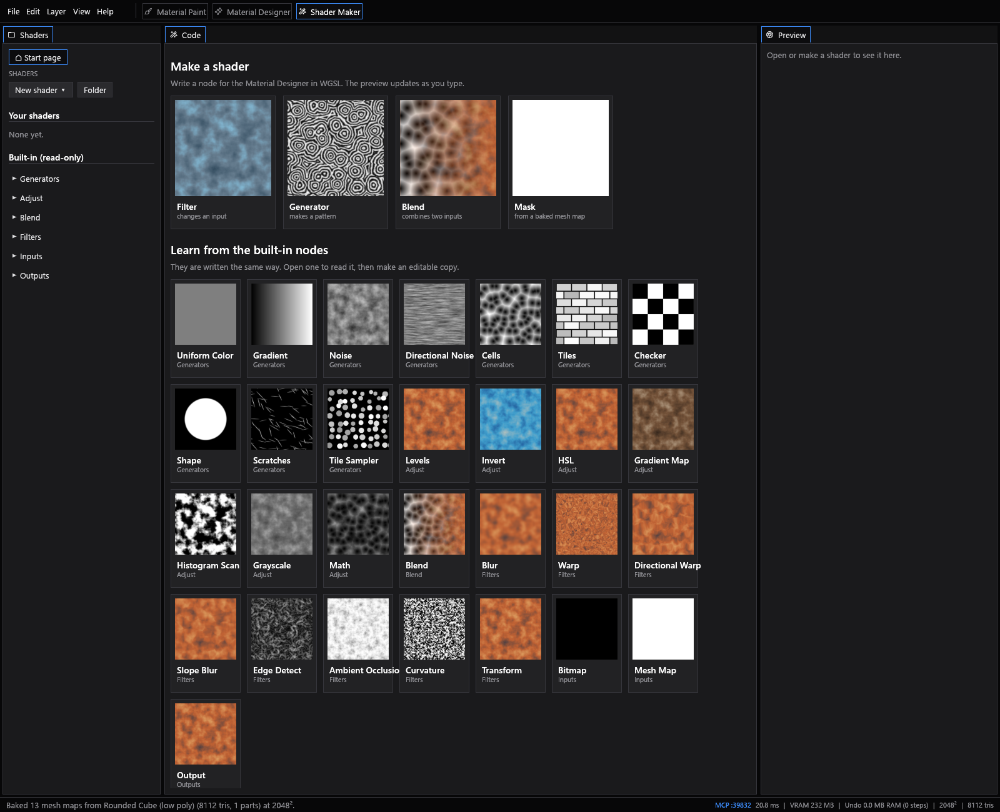
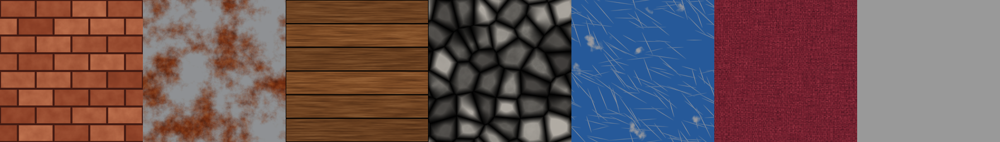

# Material Painter

A fast, lightweight PBR texture painter for game and film assets: paint
materials onto 3D models with layers, smart materials and masks, bake mesh
maps, build materials in a node graph and write your own node shaders.



> **Early access.** Material Painter works and is in daily use, but it is
> young: expect rough edges, and please report what you find.

## Features

- **Material Paint**: a layer stack with paint, fill and folder layers, blend
  modes and opacity; brushes with tips, grain, pen pressure, stabilizer,
  symmetry and screen, surface or UV projection; polygon fill by triangle,
  quad, loose part, object or UV island.
- **Smart materials and masks**: dozens of ready-made materials, smart mask
  generators (edge wear, dirt, dust, rain streaks, drips, cavity grime...),
  mask layers with blend modes, and mask filters (levels, blur, warp, noise
  breakup...).
- **Mesh map baking**: ambient occlusion, curvature, cavity, thickness,
  normal and height from a high poly, position, world normal, ID and more,
  with cages and match-by-name.
- **Material Designer**: a node graph of tileable textures that drives fill
  layers and masks, with live previews and a 3D view of the result.
- **Shader Maker**: write custom nodes in WGSL with syntax highlighting, a
  live preview and compiler errors pointing at your lines.
- **Export**: presets for Unreal, Unity (URP, HDRP, Built-in), Godot, glTF,
  Roblox and Blender, or your own channel packing; PNG, TIFF, TGA, JPEG and
  EXR at 8, 16 or 32 bits.
- **Docking workspaces**, path-traced preview, HDRI lighting, and an MCP
  server so AI agents can drive the app (off by default).

| Material Paint | Shader Maker |
| --- | --- |
|  |  |



## Download

Ready-to-run builds are on the [releases page](https://github.com/alla2001/material-painter/releases).
Buying a build supports development; the source is and stays free.

**Requirements**: Windows 10 or 11, 64-bit, and a GPU with DirectX 12 or
Vulkan support (most cards from 2016 on). 8 GB of video memory is
comfortable for 4K texture sets.

## Building from source

Install [Rust](https://rustup.rs) (stable), then:

```sh
git clone https://github.com/alla2001/material-painter
cd material-painter
cargo run --release
```

`cargo test` runs the unit tests. The GPU tests render offscreen (no window)
and write images to `target/bake_test/`:

```sh
cargo test --bin material_painter -- --ignored --test-threads 1
```

## Community

Questions, renders and shared materials: join the [Discord](https://discord.gg/TqKD5xKp7Y).
Bugs and feature requests are welcome there or as [GitHub issues](https://github.com/alla2001/material-painter/issues).

## License

Material Painter is free software under the
[GNU General Public License, version 3 or later](LICENSE).

Third-party code is listed with its licenses in
[THIRD_PARTY_NOTICES.html](THIRD_PARTY_NOTICES.html). The bundled HDRIs and
PBR textures are from [Poly Haven](https://polyhaven.com) (CC0), and the
icons are [Phosphor](https://phosphoricons.com) (MIT).
